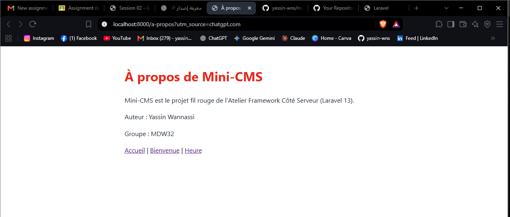
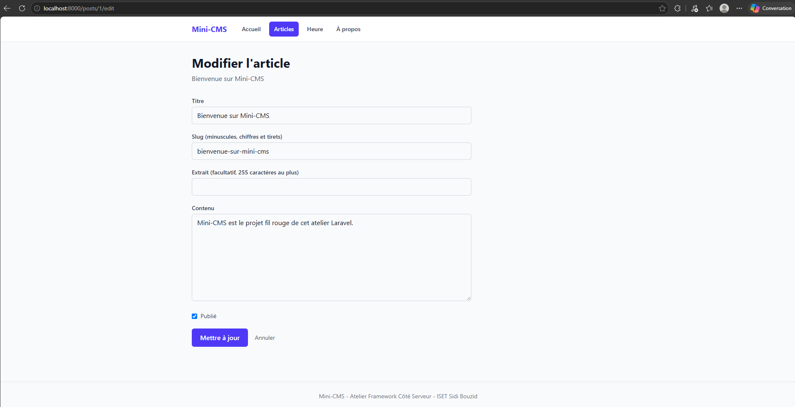
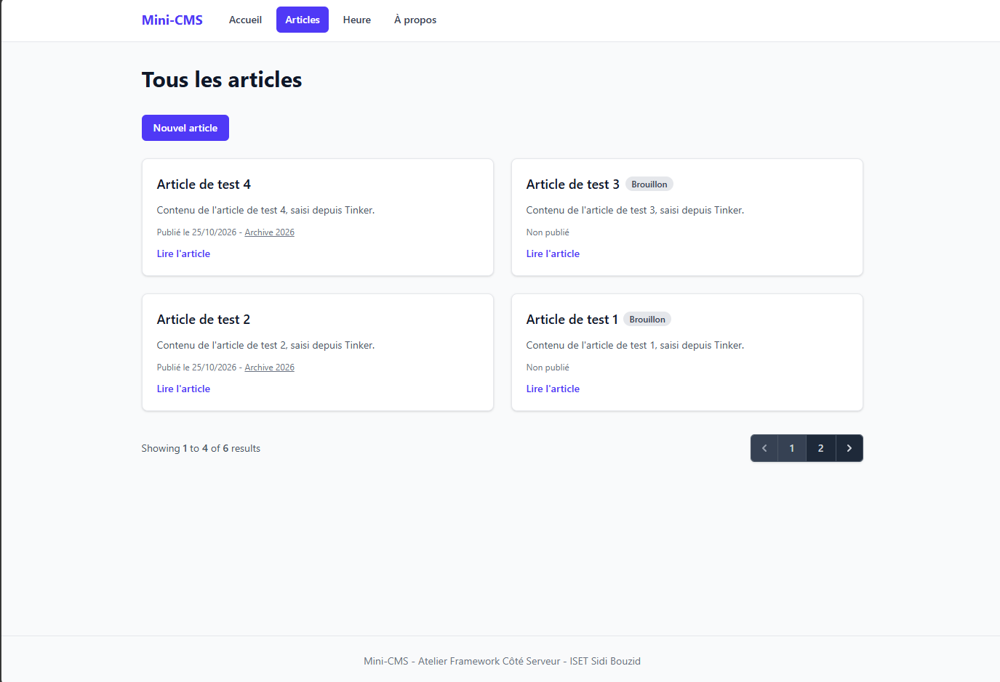

# Mini-CMS

Projet fil rouge de l'Atelier Framework Côté Serveur (Laravel 13, PHP 8.3+), 3e année MDW, ISET Sidi Bouzid.

Auteur : Yassin Wannassi, groupe MDW32.

## Description

Mini-CMS est une plateforme de publication avec un site public, un back-office authentifié et une API JSON. Les utilisateurs rédigent des articles associés à une catégorie et à des tags. L'API expose les contenus publiés en lecture et réserve les écritures aux clients munis d'un jeton Sanctum.

## Fonctionnalités

- Pages d'accueil, À propos et heure.
- Liste paginée, archives annuelles, détail et articles associés.
- Création, modification, suppression et publication d'articles selon le propriétaire et les permissions administrateur.
- Gestion des catégories et des tags par les administrateurs.
- Inscription et connexion par session pour le site.
- API JSON avec lecture des articles, catégories et tags, et filtres par catégorie ou tag.
- Connexion API par jeton Bearer Sanctum et opérations d'écriture protégées.
- Relations Eloquent, chargement anticipé, données de démonstration et tests Pest.

## Installation

Prérequis : PHP 8.3 ou plus avec `pdo_sqlite`, Composer, Node.js LTS et Git.

### Bash

```bash
git clone https://github.com/yassin-wns/mini-cms.git
cd mini-cms
composer install
npm install
npm run build
cp .env.example .env
php artisan key:generate
php artisan migrate:fresh --seed
php artisan test
composer run dev
```

### PowerShell

```powershell
git clone https://github.com/yassin-wns/mini-cms.git
cd mini-cms
composer install
npm install
npm run build
copy .env.example .env
php artisan key:generate
php artisan migrate:fresh --seed
php artisan test
composer run dev
```

Ouvrir ensuite http://localhost:8000. `migrate:fresh --seed` recrée la base SQLite et efface les données locales existantes.

## Comptes de test

La base de démonstration contient le compte administrateur suivant :

| E-mail | Mot de passe | Rôle |
|---|---|---|
| `test@example.com` | `password` | administrateur |

Les autres comptes générés par les factories ont également le mot de passe `password`.

## API

Les réponses de collections paginées ont les clés `data`, `links` et `meta`. Les listes de catégories et de tags renvoient `data` avec le nombre d'articles publiés. Les erreurs de validation sont des réponses JSON `422`.

### Endpoints

| Méthode | URI | Authentification | Résultat |
|---|---|---|---|
| GET | `/api/posts` | publique | Articles publiés, paginés (5 par défaut) |
| GET | `/api/posts?category=<slug>` | publique | Filtre par slug de catégorie |
| GET | `/api/posts?tag=<slug>` | publique | Filtre par slug de tag |
| GET | `/api/posts/{post}` | publique ou propriétaire | Détail d'un article publié ou détenu |
| GET | `/api/categories` | publique | Catégories et compte des articles publiés |
| GET | `/api/categories/{category}` | publique | Détail d'une catégorie |
| GET | `/api/tags` | publique | Tags et compte des articles publiés |
| GET | `/api/tags/{tag}` | publique | Détail d'un tag |
| POST | `/api/login` | publique | Émet un jeton Sanctum |
| GET | `/api/user` | Bearer | Profil associé au jeton |
| POST | `/api/logout` | Bearer | Révoque le jeton courant |
| POST | `/api/posts` | Bearer | Crée un article appartenant à l'utilisateur |
| PUT | `/api/posts/{post}` | Bearer et Policy | Remplace un article appartenant à l'utilisateur |
| DELETE | `/api/posts/{post}` | Bearer et Policy | Supprime un article appartenant à l'utilisateur |

Les filtres `category`, `tag` et `per_page` sont validés. `per_page` accepte une valeur de 1 à 50.

### Authentification par jeton

Envoyer `POST /api/login` avec `Accept: application/json` et le corps JSON `{"email":"test@example.com","password":"password"}`. La réponse `201` contient un jeton en clair, affiché une seule fois. La base ne conserve que son empreinte.

Pour les routes protégées, envoyer `Authorization: Bearer <jeton>` et `Accept: application/json`. `POST /api/logout` supprime uniquement le jeton présenté.

Les créations/modifications acceptent les champs `title`, `slug`, `excerpt`, `body`, `is_published`, `category_id` et `tags` (tableau d'identifiants). Les articles créés appartiennent à l'utilisateur authentifié. Une modification ou suppression est permise à son propriétaire ou à un administrateur, selon la `PostPolicy`.

### Codes d'erreur

- `200` : lecture ou modification réussie.
- `201` : connexion avec jeton émis ou article créé.
- `204` : déconnexion ou suppression réussie, sans corps.
- `401` : jeton absent, invalide ou révoqué.
- `403` : action refusée par la `PostPolicy`.
- `404` : article, catégorie ou tag inexistant.
- `403` : article existant non accessible ou opération interdite par la `PostPolicy`.
- `422` : données invalides ou identifiants de connexion incorrects.

### Exemple curl.exe

Dans PowerShell, récupérer le jeton puis remplacer `VOTRE_JETON` dans la requête protégée :

```powershell
$login = curl.exe -s -X POST -H "Accept: application/json" -H "Content-Type: application/json" -d '{"email":"test@example.com","password":"password"}' http://localhost:8000/api/login | ConvertFrom-Json
$token = $login.token
curl.exe -H "Accept: application/json" -H "Authorization: Bearer $token" "http://localhost:8000/api/posts?per_page=2"
curl.exe -X POST -H "Accept: application/json" -H "Authorization: Bearer $token" http://localhost:8000/api/logout
```

### Captures d'écran

#### Accueil et navigation



#### Liste des articles et relations



#### Détail d'un article et articles associés


#### Formulaires




## Choix d'architecture

### Pourquoi les écritures de l'API passent par PostPolicy

Le site et l'API doivent appliquer la même règle de propriété. Les deux contrôleurs demandent donc à `PostPolicy` si la personne connectée peut modifier ou supprimer l'article; une règle ne peut ainsi pas être contournée en utilisant l'API plutôt que le formulaire.

### Pourquoi preventLazyLoading est activé

Les vues et les Resources lisent les auteurs, catégories et tags des articles. Sans chargement anticipé, parcourir une liste pourrait lancer une requête supplémentaire par article. `preventLazyLoading` rend cet oubli visible hors production, tandis que `with()` regroupe les lectures nécessaires.

### Pourquoi l'API utilise des jetons et non la session

Un client API tel que Postman ou une application mobile n'utilise pas la session web du navigateur. Il envoie un jeton Bearer à chaque requête protégée. Sanctum ne conserve en base que l'empreinte du jeton et permet de révoquer celui utilisé pour la déconnexion sans invalider les autres appareils.
